<div align="center">

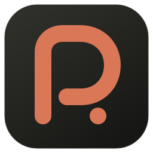

# Codex Pulse

**Quotas, tasks, and local usage for Codex, Claude Code, and Grok CLI, from the menu bar and the notch.**

[简体中文](README.md) · [Download v1.12.0](https://github.com/suguxiaojie/codex-pulse/releases/tag/v1.12.0) · [MIT License](LICENSE)

macOS 13+ · Native SwiftUI / AppKit · Apple Silicon / Intel

</div>

Codex Pulse is a native macOS menu bar app. Official quotas come from the local Codex App Server, the Claude status line, and the official xAI `grok` CLI. Tasks come from desktop IPC, a dedicated Hook, or local records checked against a live process. Pulse does not read account credentials.

**v1.12.0 (Build 34)** brings all three into the same interface: a Dynamic Island in the notch, a glass menu bar panel, and Monitor Center.

## Dynamic Island

The expanded island keeps a single focus card. The current task shows up to three steps and this turn's Token count. Other sessions sit in a row of capsules; click one to switch. The figure below is that same production preview from Settings, labeled 示例数据.

<p align="center">
  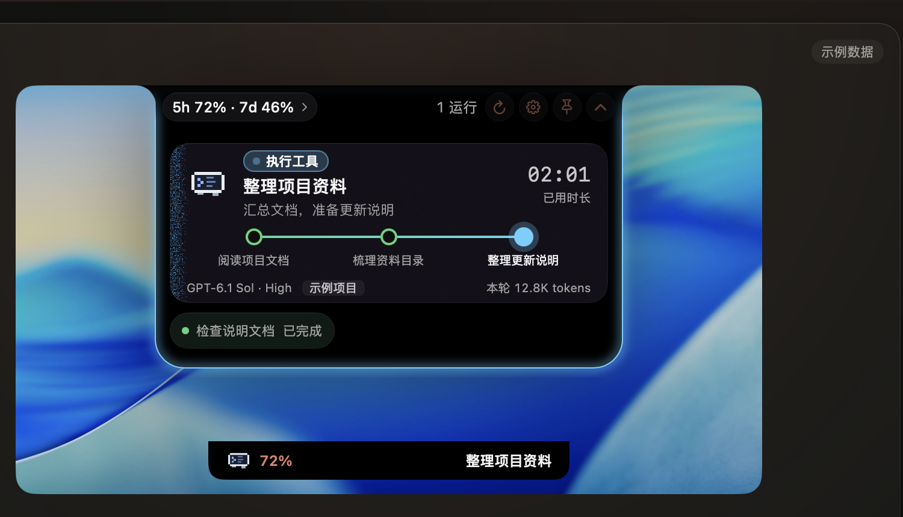
</p>

The quota at the upper left opens usage on the island. Codex, Claude Code, and Grok CLI share that page. This capture is Grok CLI on this Mac: 91% of the weekly window left, SuperGrok Plus, the shared pool and prepaid balance on separate lines, and local tokens with the CLI-reported cost marked as a partial record.

<p align="center">
  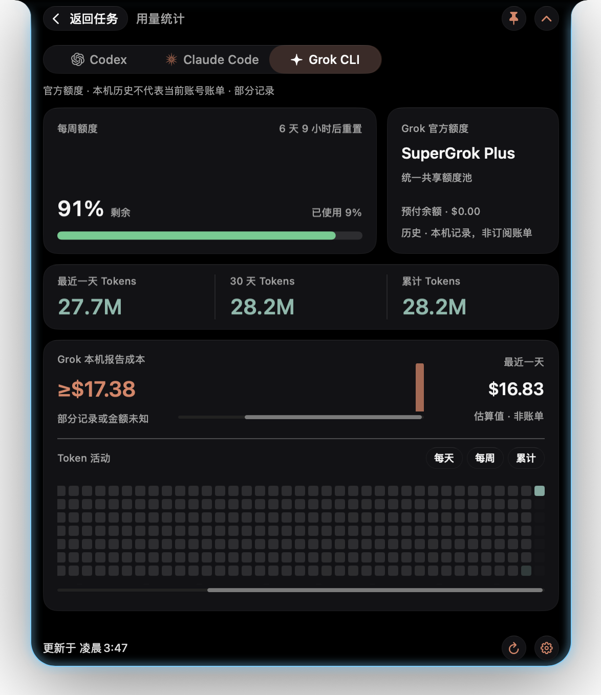
</p>

- The shell matches the notch, with concave top corners and a thin edge light that follows task state. Codex tasks use a terminal mark, Claude Code uses Clawd, and Grok CLI uses the Grok Bot.
- A new approval or question takes focus. You can pick an option, select several, or type an answer. A Grok tool request can be allowed once or rejected once, using the original option IDs, with no lasting grant. Anything else returns to the original client. Nothing is approved automatically.
- One Native questions are read from the shared Codex daemon that is already running. An answer is limited to the current active turn. Finished turns go back to the original client. See [One Native boundaries](docs/one-native-questions.md).
- "Fast" appears only when that session explicitly enabled it. Missing evidence stays blank; a global default is not treated as session evidence.
- Completed tasks can play a sound and one of three confetti levels: light, standard, or full. Reduce Motion holds progress effects and confetti still.
- Followed signals, quota recovery, and reset-card reminders at 24, 12, and 6 hours before expiry use both a system notification and an island card. While the app is quit, missed reminders are not replayed; reopening delivers only the most urgent one.

## Glass menu bar panel

Click the menu bar icon. The header switches among Codex, Claude, and Grok. The large figure is the remaining quota in the window that runs out first. The forecast estimates pace from this cycle and shows when the window resets.

<p align="center">
  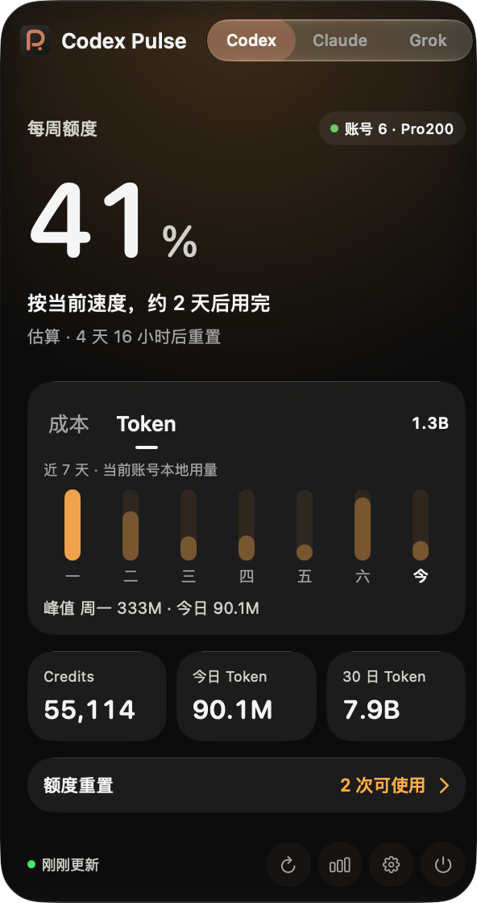
  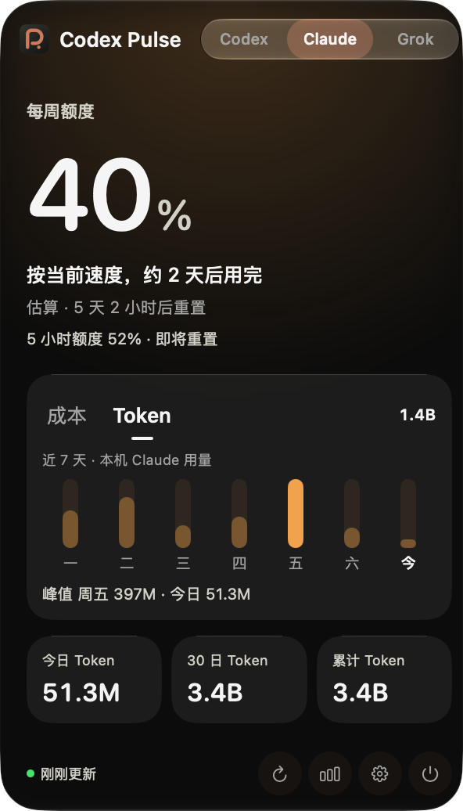
  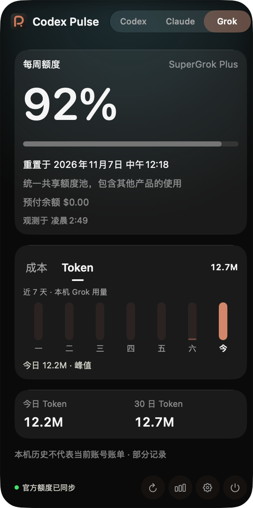
</p>

- Codex shows the plan window, a pace forecast, the last seven days of local cost or tokens, and the quota-reset entry. Paid personal plans appear as Go, Plus, Pro100, Pro200, or Pro500.
- Claude shows the 5-hour and weekly quotas. Official numbers arrive with the next Claude Code reply, through its status line.
- Grok shows the remaining percentage returned by the service, the period end, the shared quota pool, and the prepaid balance on its own line. Local history is deduplicated by prompt. Missing costs stay unknown.
- Weekdays sit under the bars. A day with an unpriced model is marked amount unknown. Reduce Transparency or Increase Contrast turns the panel opaque.

## Monitor Center

Usage, cost, community updates, sessions, and both coding-agent connections share one set of desktop cards.

<p align="center">
  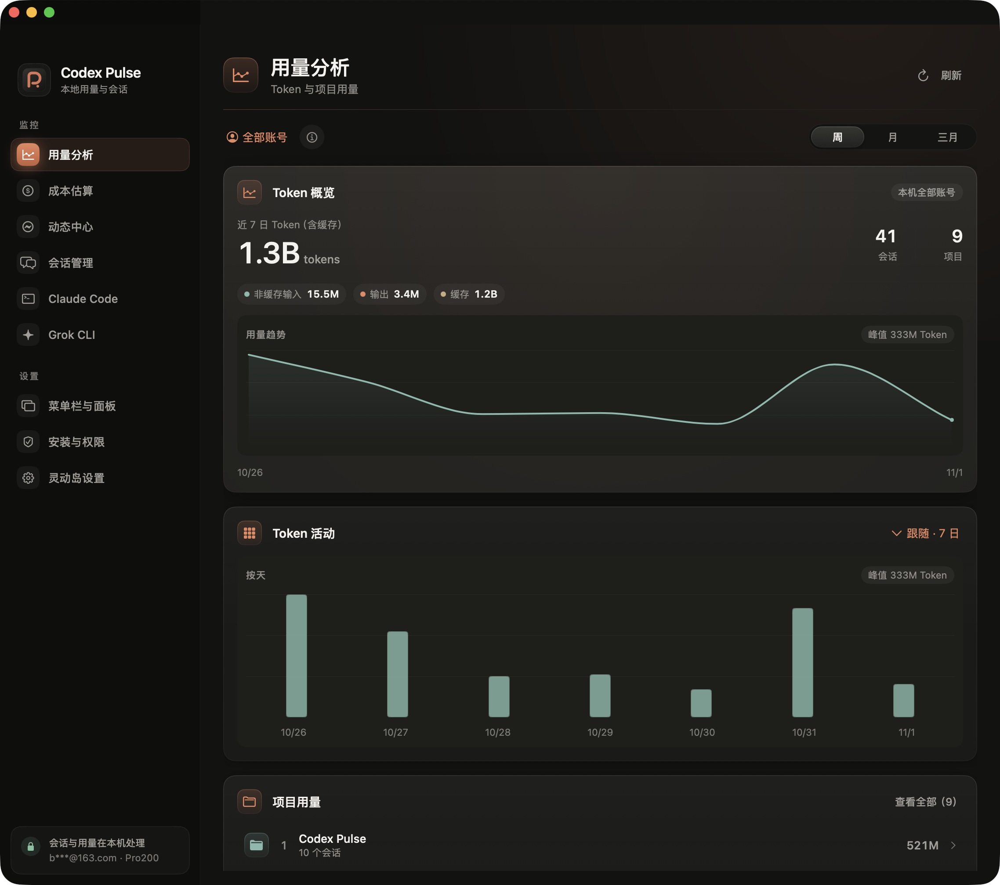
  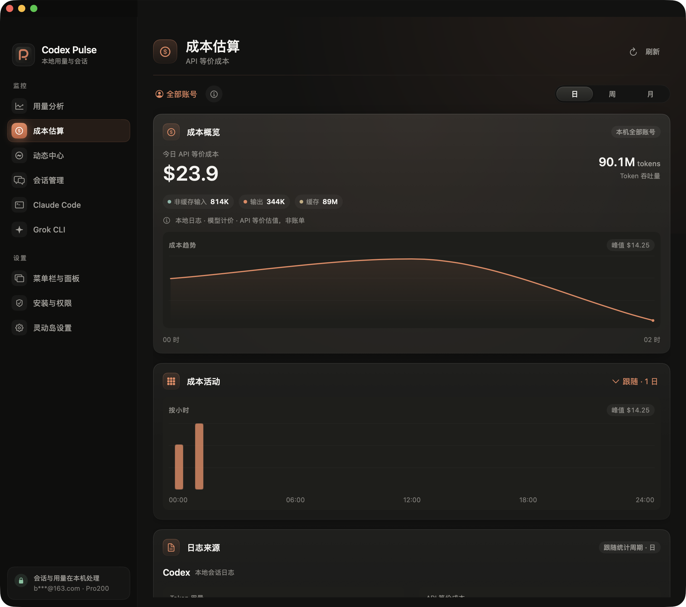
</p>
<p align="center">
  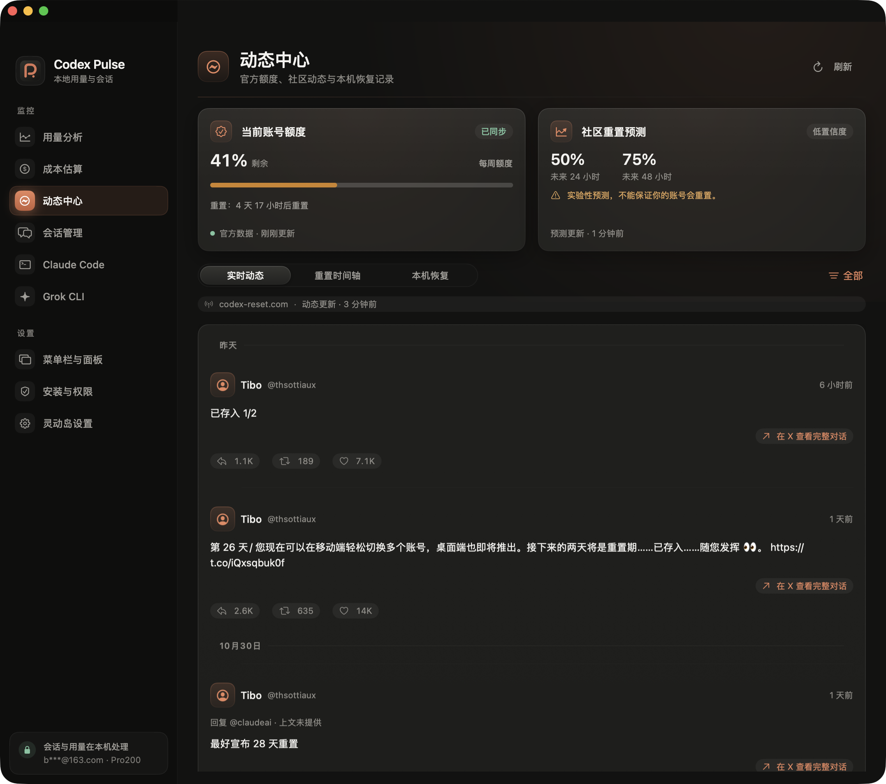
  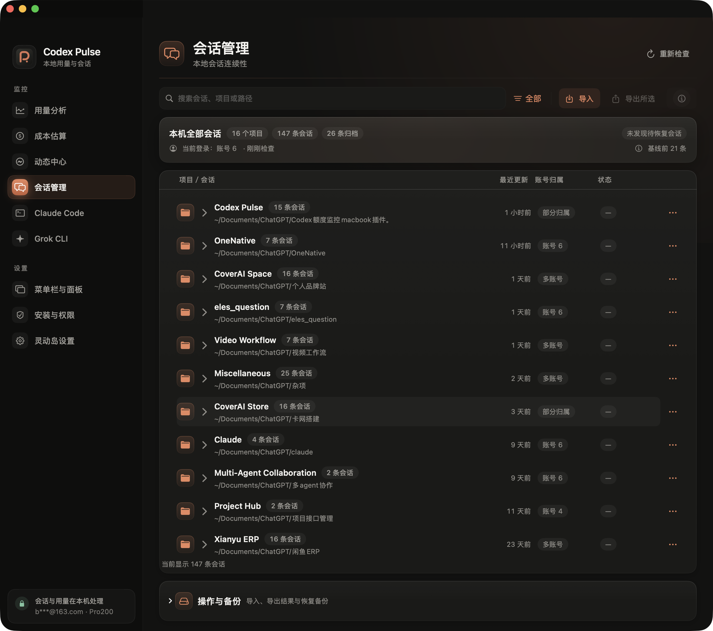
</p>
<p align="center">
  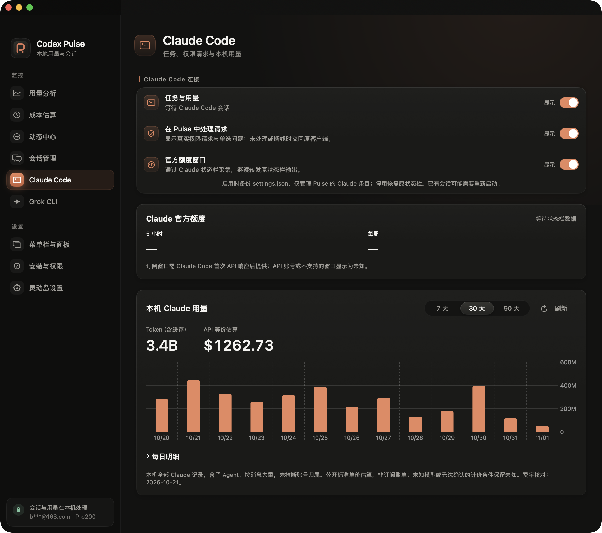
  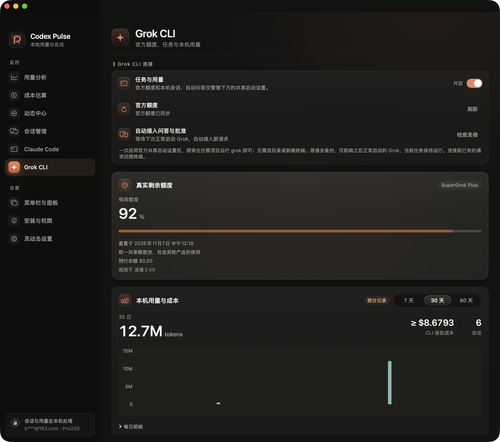
</p>

- **Usage and cost** show tokens, cache, project rank, and trend for a chosen period. Codex and Claude costs are token counts times public model prices: API-equivalent amounts, not subscription bills. Official Standard rates accept both the current and older table layouts. A failed refresh keeps the last valid prices.
- **Activity Center** places official quota, community forecasts, the reset timeline, and local recovery records side by side, each with its source. A community forecast does not mean your account will reset.
- **Session management** searches, exports Markdown or HTML, writes a raw backup, imports, and migrates. The list caches metadata and a short title. Full text is read from the original log only when you export it.
- A registered Codex project can be renamed through the desktop project service that is already running. Pulse updates the list after the saved name reads back. Folders, paths, and session membership stay put. An open Codex sidebar may need the client reopened before it shows the new name.
- A historical group with no registered Codex project can keep a Pulse-only display name, stored by its full path and kept across refresh and restart. A native project name wins.
- Deleting a project can remove the sessions only, or move that project's independent folder and everything in it to the Trash. Moving the folder requires a unique registration, the original working directory, and the folder name typed back. Shared directories, nested projects, symlinks, and mismatched paths keep the session-only delete.
- **Claude Code** is off by default. Turning it on backs up `settings.json` first and edits only Pulse's own entries. Turning it off restores the previous status line and leaves other tools alone. The island shows the current turn's public progress and real tool steps, including a Bash command description. After the monitor restarts, only sessions still marked busy in Claude's local registry come back.
- **Grok CLI** is off by default. While it is on, a short-lived official CLI query checks the remaining quota every minute, and you can refresh immediately. Transient upstream or network failures retry briefly inside a fixed time limit. A lasting failure keeps the previous observation clearly marked. After the period actually ends, the old percentage is hidden. Context length is never shown as subscription quota. A live task has to match a process. Idle terminals and old completions do not announce again.

Automatic integration, only after you turn Grok on, manages the official shared-startup switch `cli.use_leader` and backs up the previous value first. Then run `grok` as usual. Pulse recognizes the session and project. It does not ask you to pick a folder or open a terminal. A standalone task that is already running stays where it is. A disconnect does not cancel the original request, and an unclear result is not sent again. Stopping Pulse monitoring leaves the switch as it is; the backup is there if you want the old value back. See [Grok CLI integration](docs/grok-cli-integration.md) and [island question boundaries](docs/grok-island-questions.md).

After first enabling integration, fully exit the existing Grok CLI once the current task finishes, then launch it again. `/new` creates a session inside the same process and does not reload shared-startup settings. Run `grok -c` in the original project directory to continue the most recent session. Without a shared connection, choices and approvals remain in the original Grok window.

## Settings

Island, glass panel, and permissions are edited in Monitor Center and apply immediately. Large numbers use 万 and 亿 by default, for example `8,432`, `541万`, and `1.84亿`. You can switch to K / M / B. Amounts, percentages, and session counts stay as they are.

The island at the top of Settings is the production component drawing a sample, labeled 示例数据. The glass panel beside it uses the signed-in account and is labeled read-only.

<p align="center">
  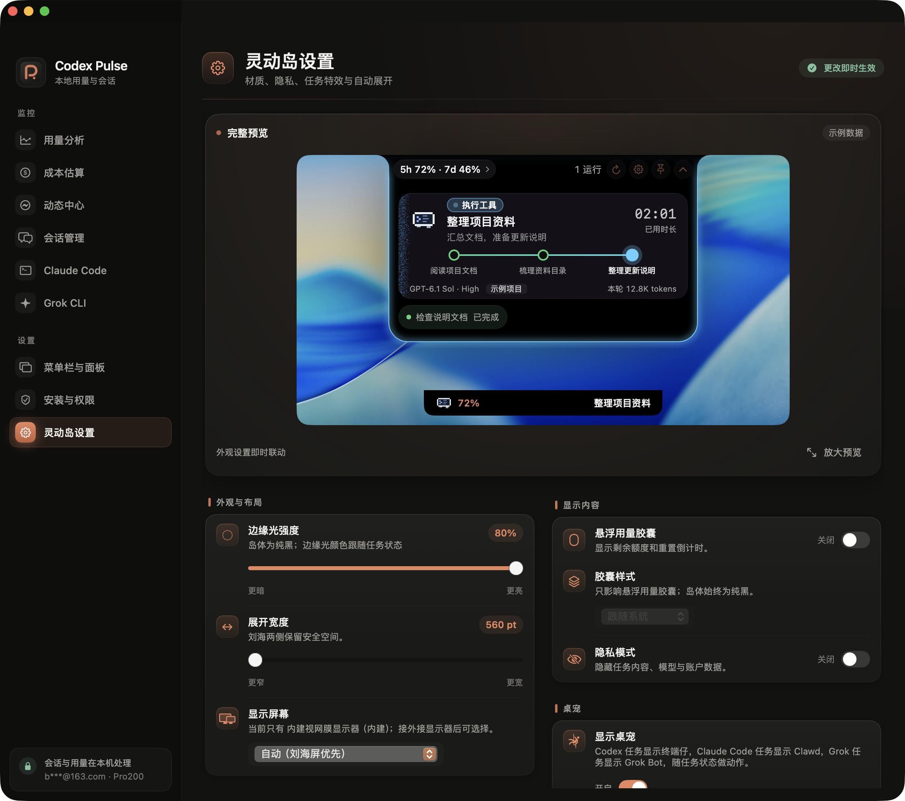
  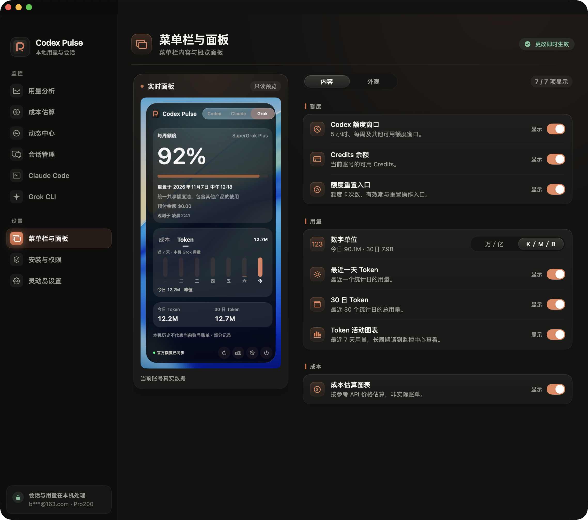
</p>

<details>
<summary>Installation and permissions</summary>
<p align="center">
  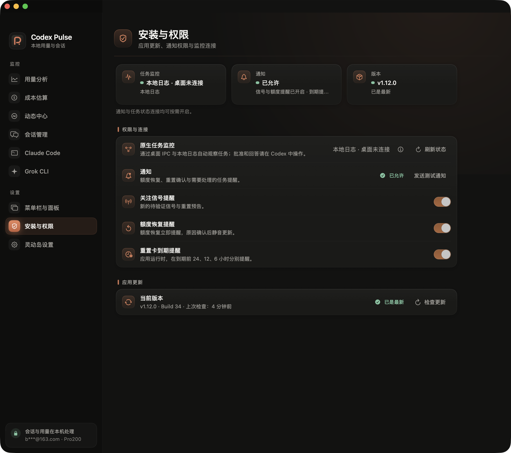
</p>
</details>

## Download and install

Download the build for this Mac from [GitHub Releases](https://github.com/suguxiaojie/codex-pulse/releases/tag/v1.12.0):

| Mac processor | Installer |
|---|---|
| Apple Silicon (M series) | [arm64 DMG](https://github.com/suguxiaojie/codex-pulse/releases/download/v1.12.0/CodexNotchMonitor-v1.12.0-arm64.dmg) |
| Intel | [x86_64 DMG](https://github.com/suguxiaojie/codex-pulse/releases/download/v1.12.0/CodexNotchMonitor-v1.12.0-x86_64.dmg) |

1. Open the DMG and drag the app into Applications.
2. Launch it. Codex quota needs a signed-in Codex or ChatGPT Desktop on this Mac.
3. Turn on notifications when you want reminders. The task-monitoring connection is under Installation and Permissions.

The installer is ad-hoc signed and not notarized by Apple. If macOS blocks the first launch, confirm where the file came from, then allow it in System Settings → Privacy & Security.

The app was renamed from Codex Monitor. Its bundle ID, `CodexNotchMonitor.app` filename, preferences, and data directories keep their previous values, so an upgrade leaves settings and data in place. Check for Updates only opens the download page. You install the update yourself.

## Where the data comes from

| Content | Source |
|---|---|
| Codex official quota and account | Local Codex App Server. The figure is a quota percentage and a reset time, not a remaining message count |
| Quota forecast | Estimated from the used percentage and elapsed time in the current window. The first hour of a cycle has no forecast |
| Tokens and project stats | Structured session logs still readable on this Mac, including cache |
| Live tasks | Codex uses desktop IPC and local logs. Claude Code uses its dedicated Hook and local registry. Grok CLI uses local updates matched to a process |
| Cost | Codex and Claude use tokens times public prices. Grok uses the cost reported by the CLI for that turn. None of these are subscription bills. Unknown amounts are labeled |
| Community posts and forecasts | Third-party aggregate [codex-reset.com](https://codex-reset.com/zh/tibo) |
| Session account ownership | Only ownership Pulse actually observed. Sessions from before the baseline, or without enough evidence, stay Unassigned |

- Pulse does not read `auth.json`, cookies, API keys, Claude credentials, or the Keychain. Local sessions, projects, and usage are not uploaded to the community source or the price catalog.
- Codex task monitoring installs no Hook and does not write Codex client configuration.
- Import, restore, delete, migrate, and manual quota reset start only when you choose them, and the scope is shown first. A quota reset asks a second time.
- Readable exports hide sensitive body text by default. Raw backups and migration packages can contain source, prompts, and attachments. Keep them yourself.

## Build from source

Requires the Swift 6 toolchain and macOS build tools. There are no third-party Swift Package dependencies.

```bash
git clone https://github.com/suguxiaojie/codex-pulse.git
cd codex-pulse
./scripts/build-app.sh native        # Build for this Mac
open build/CodexNotchMonitor.app
```

```bash
./scripts/test.sh                    # Full tests, including Claude integration
SKIP_COST_SMOKE_TESTS=1 ./scripts/test.sh
./scripts/build-dmg.sh arm64         # Apple Silicon installer
./scripts/build-dmg.sh x86_64        # Intel installer
```

More detail:

- [In-island approvals](docs/island-approvals.md)
- [Claude Code integration](docs/claude-code-integration.md)
- [Grok CLI integration](docs/grok-cli-integration.md)
- [Compressed session history](docs/compressed-rollouts.md)
- [Roadmap](ROADMAP.md)

## Acknowledgments and license

Thanks to [Codex Island](https://github.com/ericjypark/codex-island), [QuotaView](https://github.com/Duoasa/QuotaView), and [Open Claude UI](https://github.com/Caho1/open-claude-ui). Third-party sources and full licenses are in [THIRD_PARTY_NOTICES.md](THIRD_PARTY_NOTICES.md).

This project is licensed under the [MIT License](LICENSE), Copyright (c) 2026 CoverAI. Codex Pulse is an independent project and is not affiliated with OpenAI, Anthropic, or xAI.

Support the project: [CoverAI's top-up service](https://www.coverai.store/).
