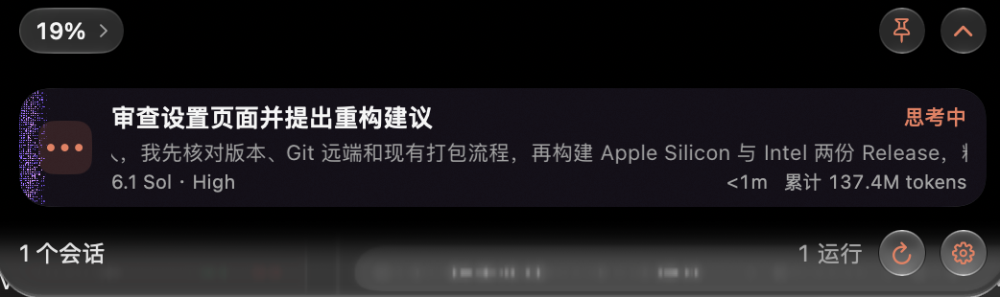
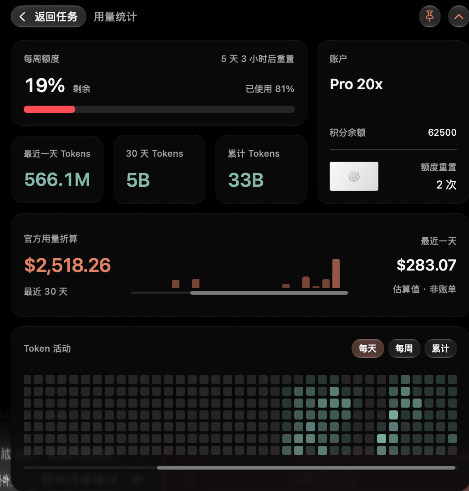

<div align="center">


# Codex Pulse

**Keep Codex quotas, live tasks and local usage in your menu bar and Activity Island.**

[简体中文](README.md) · [Download v1.8.0](https://github.com/suguxiaojie/codex-notch-monitor/releases/tag/v1.8.0) · [MIT License](LICENSE)

macOS 13+ · SwiftUI / AppKit · Apple Silicon / Intel

</div>

## Features

- **Quota at a glance**: current-account quota windows, reset countdowns, Credits and recovery records.
- **Live tasks**: execution stages, tool progress, approval waits and result summaries, with multiple sessions, privacy mode and optional effects.
- **Usage and cost**: Token/cache totals, project rankings and trends by period; API-equivalent cost estimates using public model prices.
- **Dynamic Center**: official quotas, community updates, reset timelines and local recovery records with separate source labels.
- **Session management**: project/session search, ownership and exception summaries, Markdown/HTML exports, raw backups, imports and project transfers.
- **Native appearance**: warm neutral surfaces and clay accents, native glass, Light/Dark/Auto appearance, live settings previews and accessibility support.

Task monitoring uses read-only desktop IPC and local logs without installing Hooks. Approvals and answers stay in Codex.

## Screenshots

### Activity Island: live tasks and usage

<p align="center">
  
</p>
<p align="center">
  
</p>

### Usage and cost

<p align="center">
  
  
</p>

### Dynamic Center and sessions

<p align="center">
  
  
</p>

### Panel and Activity Island settings

<p align="center">
  
  
</p>

<details>
<summary>Setup and permissions</summary>

<p align="center">
  
</p>

</details>

## Download and install

Current version: **v1.8.0 (Build 26)**. Choose the installer for your processor from [GitHub Releases](https://github.com/suguxiaojie/codex-notch-monitor/releases/tag/v1.8.0).

| Mac processor | Installer |
|---|---|
| Apple Silicon (M series) | [arm64 DMG](https://github.com/suguxiaojie/codex-notch-monitor/releases/download/v1.8.0/CodexNotchMonitor-v1.8.0-arm64.dmg) |
| Intel | [x86_64 DMG](https://github.com/suguxiaojie/codex-notch-monitor/releases/download/v1.8.0/CodexNotchMonitor-v1.8.0-x86_64.dmg) |

1. Open the DMG and drag the app into Applications.
2. Launch it with Codex/ChatGPT Desktop installed and signed in.
3. Enable notifications if wanted and check monitoring connectivity in Setup & Permissions.

The app is ad-hoc signed and has not been notarized by Apple. If macOS blocks the first launch, verify the download source and allow it in System Settings → Privacy & Security.

The display name changed from Codex Monitor to Codex Pulse. The Bundle ID, `CodexNotchMonitor.app` filename, preference keys and data directories remain unchanged to retain existing configuration and data. Update checks open a download URL; installation remains under your control.

## Sources and boundaries

| Data | Source and meaning |
|---|---|
| Official quotas and account | Local Codex App Server; quota percentages and reset times are not remaining message counts |
| Tokens and projects | Local structured session logs including cache; limited to readable history on this Mac |
| Live tasks | Read-only desktop IPC and local logs; client-version-dependent protocol with log fallback |
| Cost | Tokens × public model prices; **API-equivalent estimates, not subscription bills**; unknown prices are labeled |
| Community updates and forecasts | Third-party aggregation from [codex-reset.com](https://codex-reset.com/zh/tibo); forecasts do not guarantee a reset |
| Session ownership | Reliably observed evidence only; pre-baseline and insufficiently attributed records stay unattributed |

- Normal monitoring does not read `auth.json`, cookies, API keys or passwords, or upload local sessions, project names or usage to community/price services.
- Readable exports process selected sessions locally and redact sensitive body text by default; image pixels are not automatically redacted. Raw backups and project transfers may contain source code, prompts and attachments: keep them private.
- Import, recovery, deletion, transfer and manual quota resets are explicit user actions with scope shown beforehand. Manual resets require a second confirmation.
- Local file presence, App Server visibility and Codex sidebar visibility are reported separately.

## Build from source

Requires a Swift 6 toolchain and standard macOS build tools. No additional third-party Swift Package installation is needed.

```bash
git clone https://github.com/suguxiaojie/codex-notch-monitor.git
cd codex-notch-monitor
./scripts/build-app.sh native
open build/CodexNotchMonitor.app
```

```bash
# Run the complete test suite when needed
./scripts/test.sh

# Build the two architecture-specific DMGs
./scripts/build-dmg.sh arm64
./scripts/build-dmg.sh x86_64
```

See [compressed rollout support](docs/compressed-rollouts.md) for historical logs and [ROADMAP.md](ROADMAP.md) for project status and pending work.

## Credits and license

Thanks to [Codex Island](https://github.com/ericjypark/codex-island), [QuotaView](https://github.com/Duoasa/QuotaView) and [Open Claude UI](https://github.com/Caho1/open-claude-ui). Full third-party attribution is in [THIRD_PARTY_NOTICES.md](THIRD_PARTY_NOTICES.md).

[MIT License](LICENSE), Copyright (c) 2026 CoverAI. Codex Pulse is an independent project and is not affiliated with OpenAI.

Support the project: [CoverAI top-up service](https://www.coverai.store/).
