<div align="center">

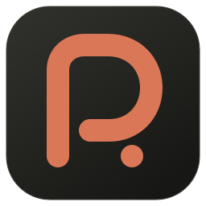

# Codex Pulse

**在菜单栏和刘海里，看清 Codex、Claude Code 与 Grok CLI 的额度、任务和本机用量。**

[English](README.en.md) · [下载 v1.12.0](https://github.com/suguxiaojie/codex-pulse/releases/tag/v1.12.0) · [MIT License](LICENSE)

macOS 13+ · 原生 SwiftUI / AppKit · Apple Silicon / Intel

</div>

Codex Pulse 是原生 macOS 菜单栏应用。官方额度来自本机 Codex App Server、Claude 状态栏和 xAI 官方 `grok`；任务来自桌面 IPC、专属 Hook 或经过进程核对的本地记录。Pulse 不读取账号凭据。

当前版本 **v1.12.0（Build 34）** 把这三路接进同一套界面：刘海里的灵动岛、菜单栏玻璃面板，以及监控中心。

## 灵动岛

展开后只有一张焦点卡片。当前任务最多显示 3 个步骤和本轮 Token，其他会话排成胶囊，点一下就能切换。下面是设置页里的同一套生产预览，角上标着「示例数据」。

<p align="center">
  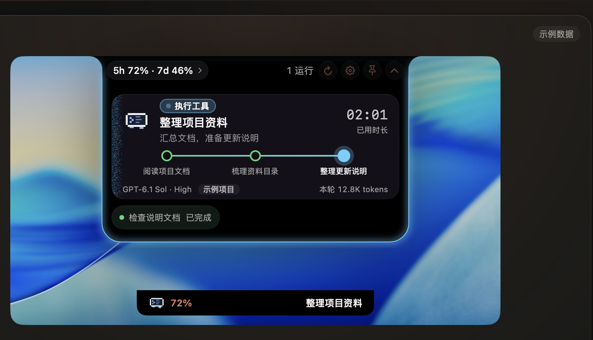
</p>

点左上角的额度，岛内打开用量统计。Codex、Claude Code、Grok CLI 在同一页切换。下面是本机的 Grok CLI：每周剩余 91%，SuperGrok Plus，共享额度池和预付余额分开显示，本机 Token 与 CLI 报告成本标着部分记录。

<p align="center">
  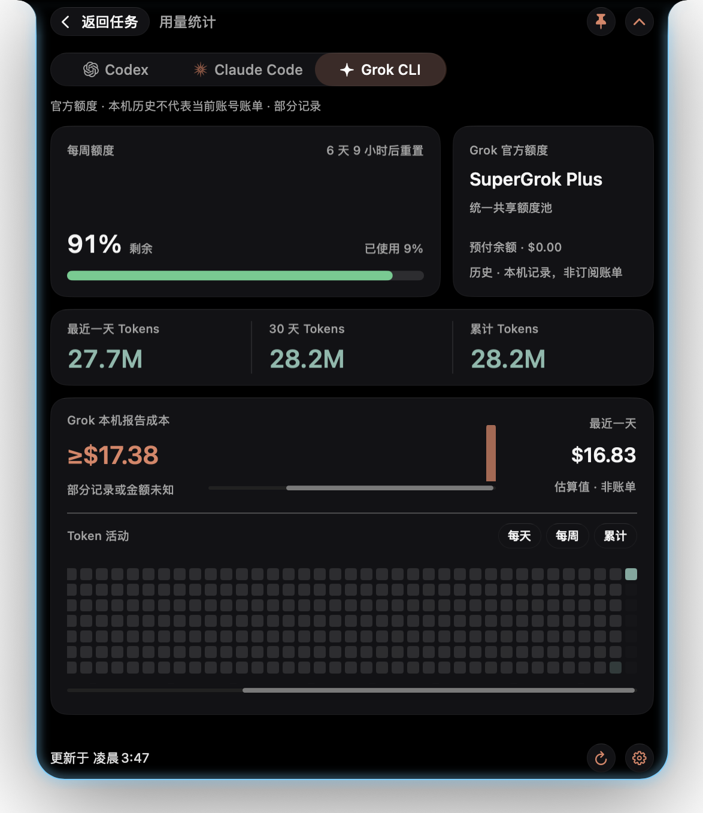
</p>

- 岛体与刘海同色，顶部内凹，边缘有一圈跟随任务状态的细光。Codex 任务显示终端图标，Claude Code 显示 Clawd，Grok CLI 显示 Grok Bot。
- 新的待批准或待回复会自动占住焦点。你可以在岛里选择、勾选或输入文字；Grok 的工具请求可以「允许一次」或「拒绝一次」，保留原生选项，不生成长期授权。其他请求交回原客户端。不会自动批准。
- One Native 的当前提问从已经在跑的共享 Codex daemon 读取，回答限定在当前活动轮次。已结束的轮次交回原客户端。详见 [One Native 接入边界](docs/one-native-questions.md)。
- 「Fast」只在当前会话明确开启时出现。缺少记录时不显示，也不用全局配置猜测。
- 任务完成可以播放提示音，并按轻、标准、热烈三档放礼花。减弱动态效果后，进度特效和礼花改为静止。
- 关注信号、额度恢复，以及重置卡到期前 24、12、6 小时，会同时走系统通知和岛内提醒。应用没开时不补历史，重新打开只补当前最紧迫的一条。

## 菜单栏玻璃面板

点菜单栏图标打开。页眉在 Codex、Claude、Grok 之间切换。大数字是当前瓶颈窗口的剩余额度，预报按本周期消耗速度估算，并标明重置时间。

<p align="center">
  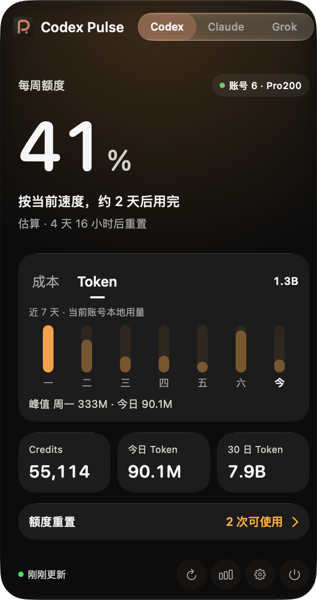
  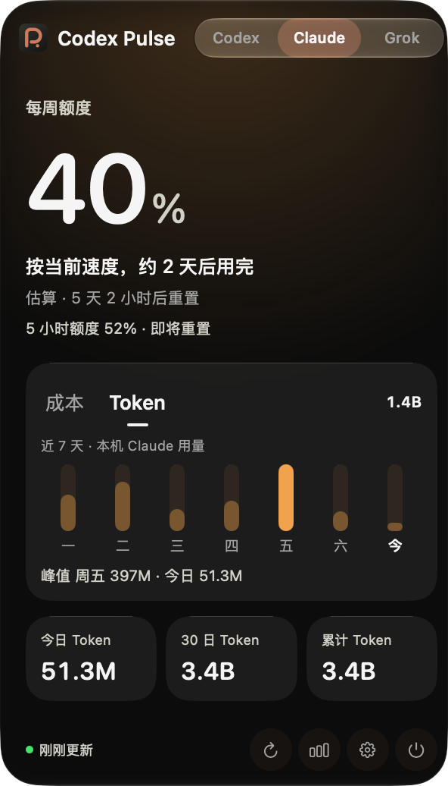
  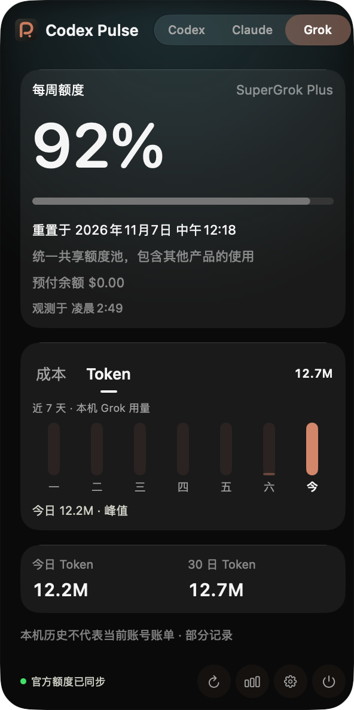
</p>

- Codex 显示套餐窗口、速度预报、近 7 天本机成本或 Token，以及额度重置入口。个人付费套餐显示为 Go、Plus、Pro100、Pro200、Pro500。
- Claude 显示 5 小时和每周额度。官方额度要等 Claude Code 下一次回复后，由状态栏带回来。
- Grok 显示服务端返回的真实剩余比例、周期结束时间、统一共享额度池和单独的预付余额。本机历史按 prompt 去重，缺失成本保持未知。
- 柱子下方只标星期。有未计价模型的日子会标成金额未知。系统打开降低透明度或增强对比度时，面板改为不透明。

## 监控中心

监控中心把用量、成本、社区动态、会话和两个编程代理的连接放在同一套桌面卡片里。

<p align="center">
  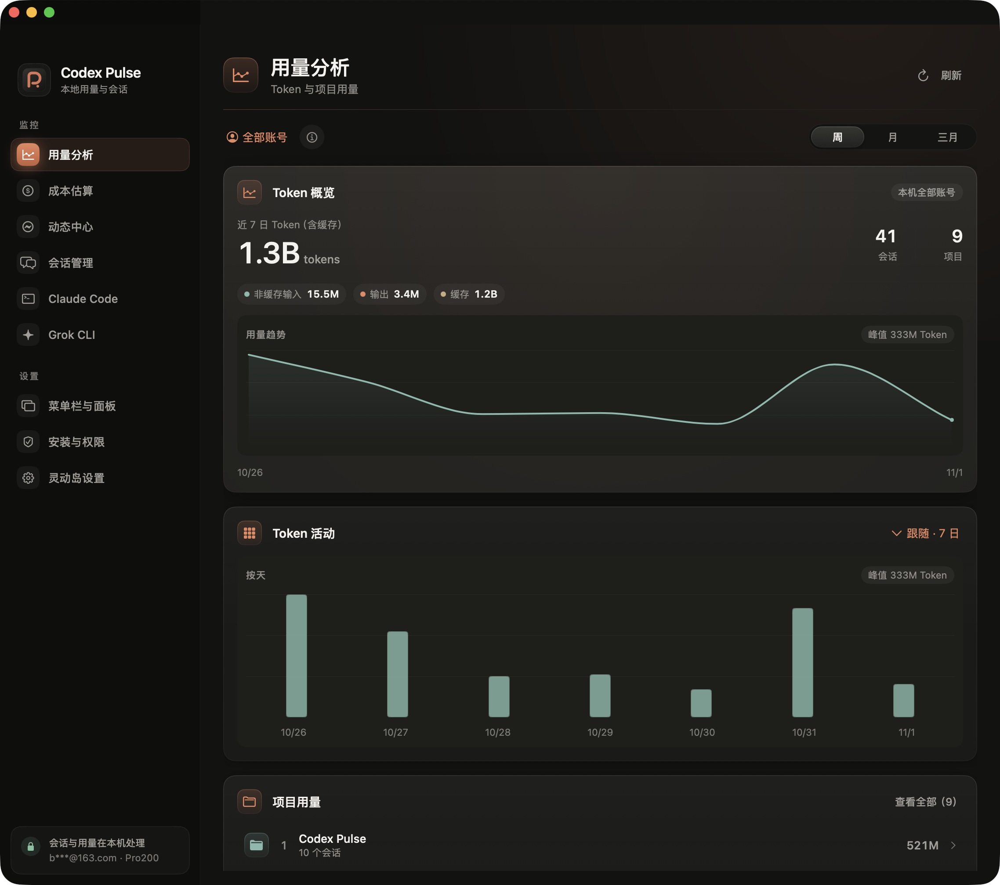
  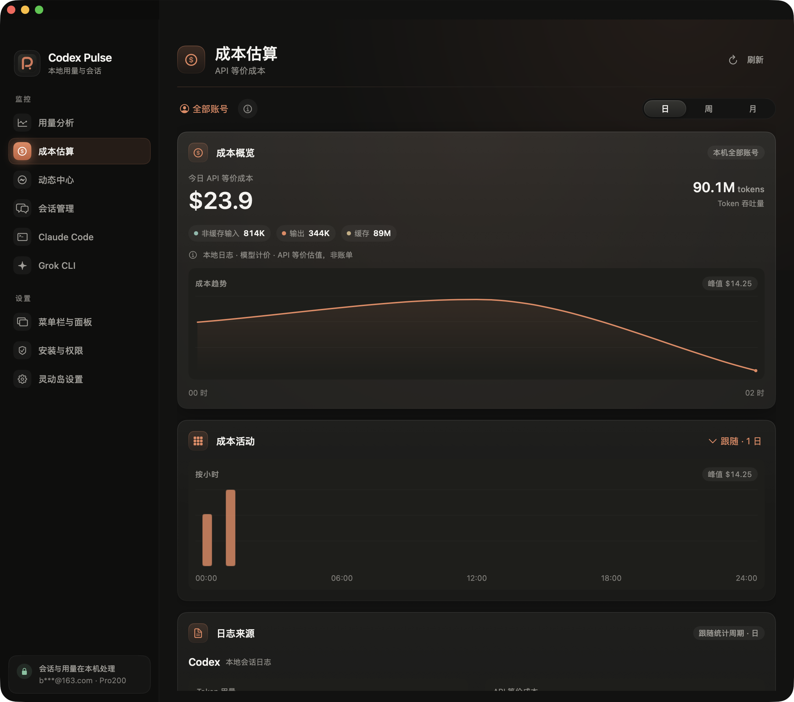
</p>
<p align="center">
  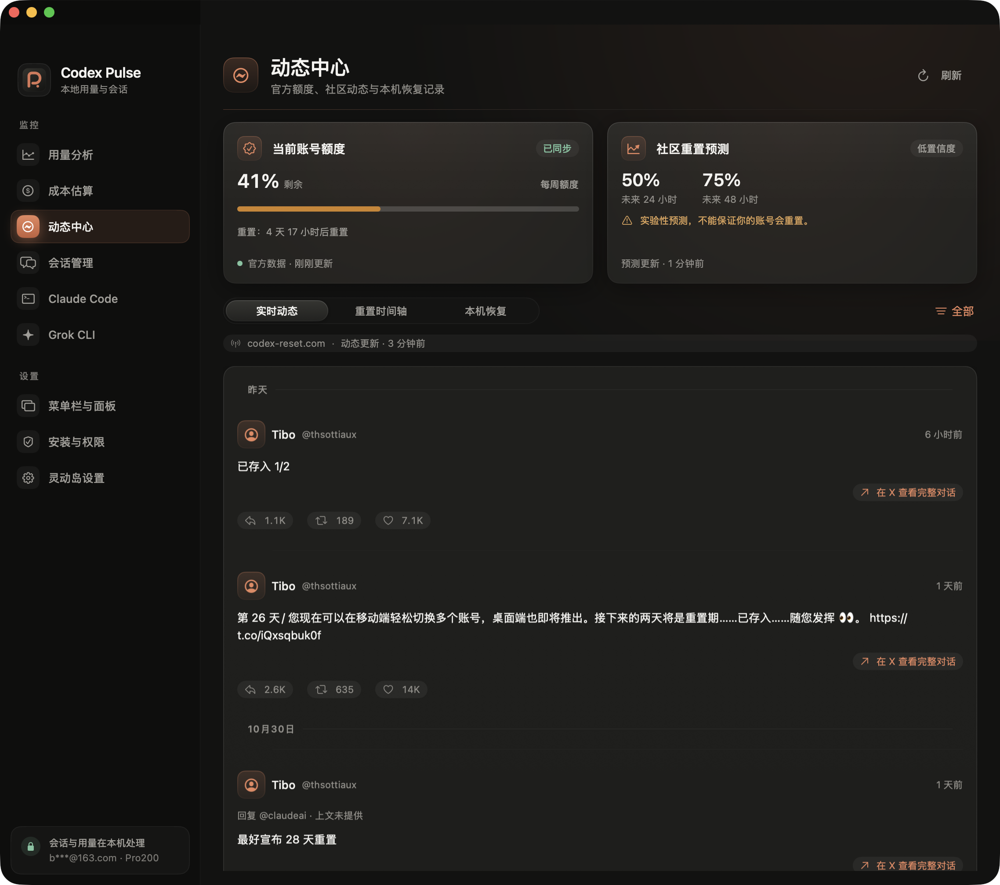
  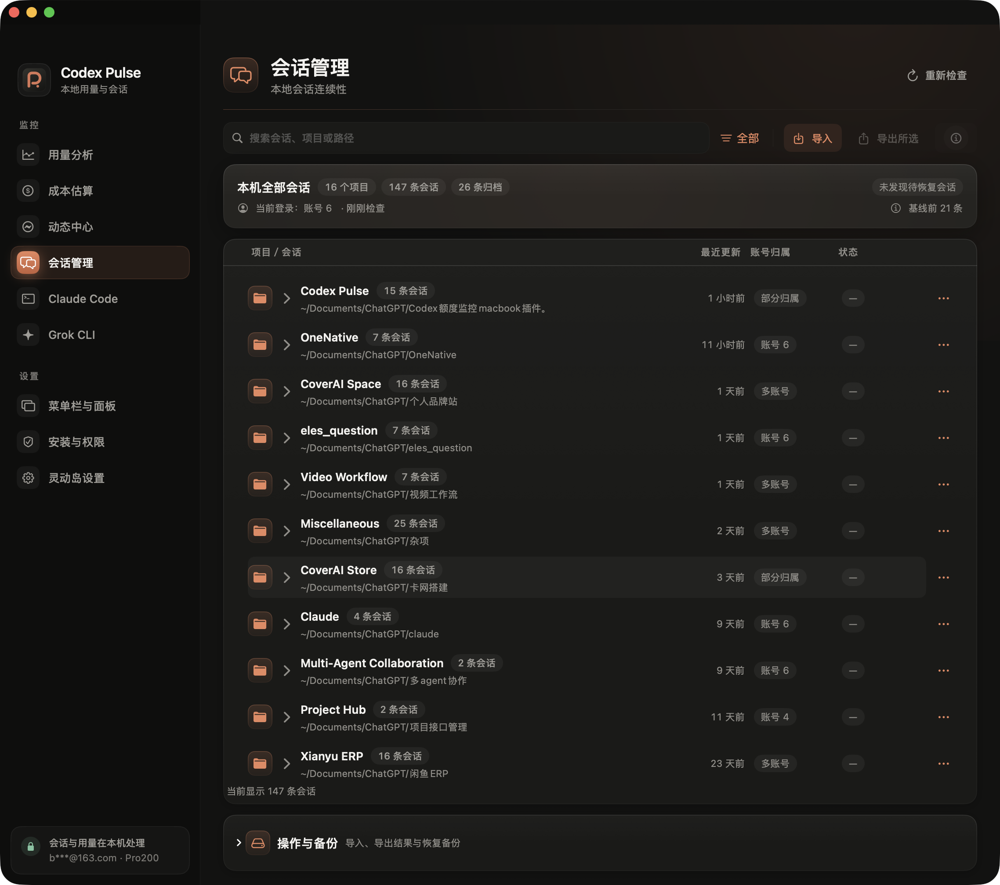
</p>
<p align="center">
  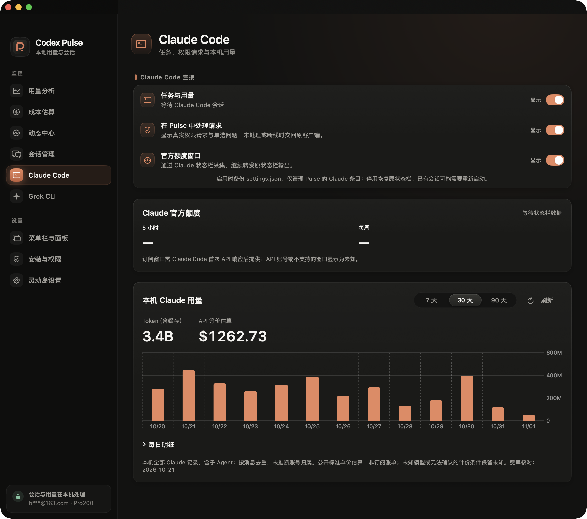
  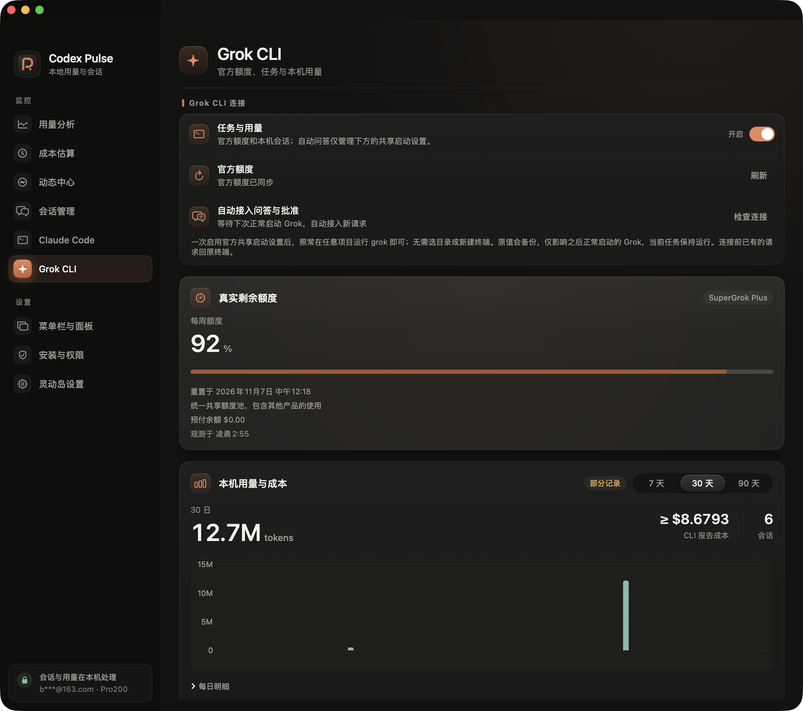
</p>

- **用量与成本**按周期看 Token、缓存、项目排行和趋势。Codex、Claude 的成本按公开模型价格估算，是 API 等价金额，不是订阅账单。官方 Standard 费率能读新旧价格表，更新失败时保留最后一次有效价格。
- **动态中心**并排显示官方额度、社区预测、重置时间轴和本机恢复记录，每条都标来源。社区预测不能保证你的账号会重置。
- **会话管理**可以搜索、导出 Markdown 或 HTML、做原始备份、导入和迁移。列表只缓存元数据和短标题，导出正文时才读原始日志。
- 已登记的 Codex 项目可以用正在运行的桌面项目服务重命名。Pulse 回读确认后再更新列表，不改文件夹、路径或会话绑定。侧栏如果还开着，可能要重新打开 Codex 客户端才会刷新。
- 没有 Codex 项目登记的历史分组，可以按完整路径在 Pulse 里单独起显示名。这个名字只存在本应用偏好里，刷新和重启后还在。原生项目名优先。
- 删除项目时可以只删会话，也可以把该项目独立文件夹整份移入废纸篓。移文件夹前会核对唯一登记和原始工作目录，并要求输入文件夹名。共享目录、嵌套项目、符号链接或路径对不上时，只保留删会话。
- **Claude Code** 默认关闭。打开前先备份 `settings.json`，只改 Pulse 自己的条目；关掉时恢复原来的状态栏，其他工具的配置留着。灵动岛显示本轮公开进展和真实工具步骤，Bash 显示命令描述。监控重启后，只恢复本地登记里仍然忙碌的会话。
- **Grok CLI** 默认关闭。打开后每分钟用一次短生命周期的官方 CLI 查询剩余额度，也可以手动刷新。临时的上游或网络故障会在总时限内短重试；持续失败时保留带标记的上次观测，周期真正结束后不再显示旧比例。不把上下文长度当成订阅额度。实时任务必须对得上进程身份，空闲终端和旧的完成记录不会再响一次。

自动接入只在你打开 Grok 时管理官方共享启动开关 `cli.use_leader`，并先备份原来的值。之后照常运行 `grok`，Pulse 识别会话和项目，不替你选目录，也不另开终端。已经在跑的独立任务不会被重启或迁走。断线不取消原请求，结果不清楚时不重发。关闭 Pulse 的监控不会改回这个开关，原来的备份可以自己恢复。说明见 [Grok CLI 接入](docs/grok-cli-integration.md) 和 [岛内问答边界](docs/grok-island-questions.md)。

首次启用后，原有 Grok CLI 需要在任务结束后完整退出并重新运行一次；`/new` 只新建会话，不会重载共享启动设置。在原项目目录运行 `grok -c` 可以接续最近会话。未建立共享连接时，选择和批准仍在原 Grok 窗口处理。

## 设置

灵动岛、玻璃面板和权限都在监控中心里改，改完立即生效。数字默认用万和亿，例如 `8,432`、`541万`、`1.84亿`，也可以改成 K／M／B。金额、百分比和会话数不受影响。

设置页上方的岛是同一套生产组件画出的示例，角上标着「示例数据」。旁边的玻璃面板用的是当前账号的真实额度，并标着「只读预览」。

<p align="center">
  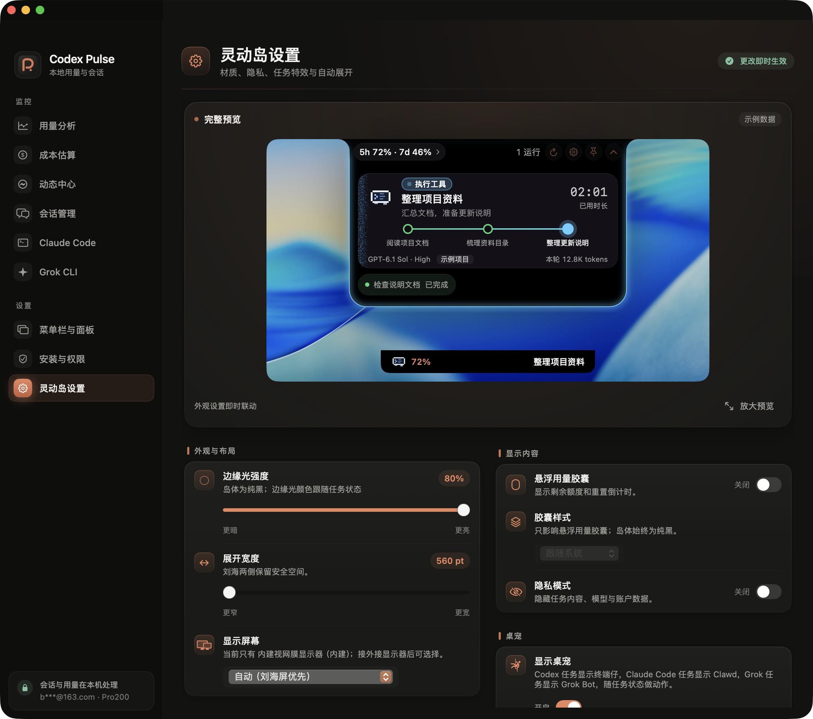
  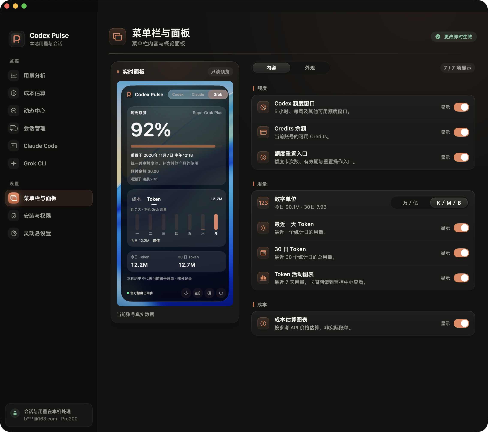
</p>

<details>
<summary>安装与权限</summary>
<p align="center">
  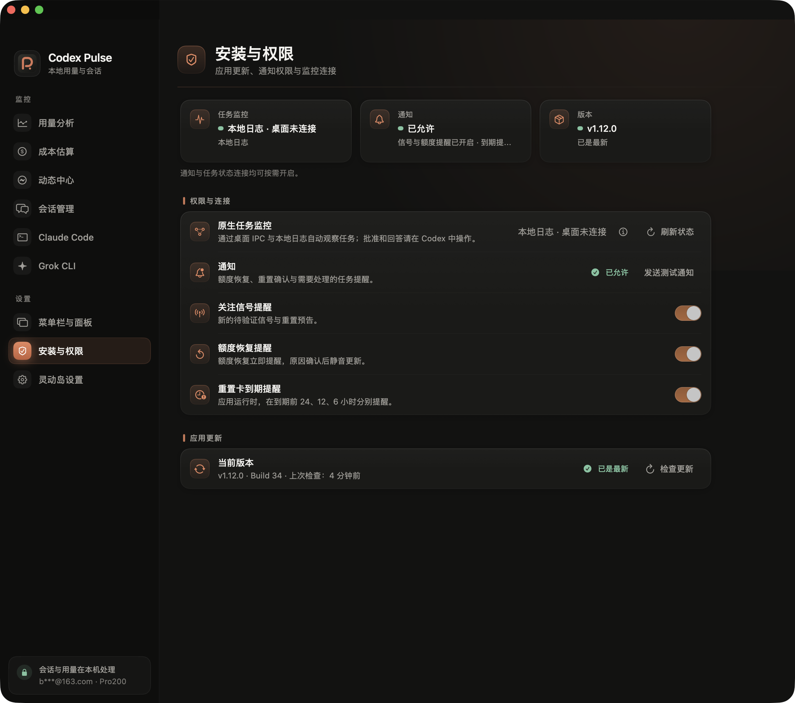
</p>
</details>

## 下载与安装

在 [GitHub Releases](https://github.com/suguxiaojie/codex-pulse/releases/tag/v1.12.0) 下载和这台 Mac 对应的安装包：

| Mac 处理器 | 安装包 |
|---|---|
| Apple Silicon（M 系列） | [arm64 DMG](https://github.com/suguxiaojie/codex-pulse/releases/download/v1.12.0/CodexNotchMonitor-v1.12.0-arm64.dmg) |
| Intel | [x86_64 DMG](https://github.com/suguxiaojie/codex-pulse/releases/download/v1.12.0/CodexNotchMonitor-v1.12.0-x86_64.dmg) |

1. 打开 DMG，把 App 拖进「应用程序」。
2. 启动 App。Codex 额度需要本机已登录的 Codex／ChatGPT Desktop。
3. 需要提醒时再打开通知。任务监控的连接状态在「安装与权限」。

安装包是临时签名，还没有 Apple 公证。如果系统拦住第一次打开，先确认下载来源，再在「系统设置 → 隐私与安全性」里允许。

应用由 Codex Monitor 更名而来。Bundle ID、`CodexNotchMonitor.app` 文件名、偏好和数据目录都沿用原来的值，升级后配置和数据还在。应用里的「检查更新」只打开下载页，安装由你自己完成。

## 数据从哪来

| 内容 | 来源 |
|---|---|
| Codex 官方额度与账号 | 本机 Codex App Server。显示的是额度比例和重置时间，不是剩余消息条数 |
| 额度预报 | 用当前窗口已用比例和已经过去的时间估算。周期开始不到 1 小时时不预报 |
| Token 与项目统计 | 本机还能读到的结构化会话日志，包含缓存 |
| 实时任务 | Codex 用桌面 IPC 和本地日志；Claude Code 用专属 Hook 和本地登记；Grok CLI 用对得上进程身份的本地通知 |
| 成本 | Codex、Claude 按 Token × 公开价格估算；Grok 用 CLI 报告的轮次成本。都不是订阅账单，未知金额会标出来 |
| 社区动态与预测 | 第三方聚合 [codex-reset.com](https://codex-reset.com/zh/tibo) |
| 会话账号归属 | 只记录可靠看到的归属。基线之前或证据不够的会话保持「未归属」 |

- 不读 `auth.json`、Cookie、API Key、Claude 凭据或钥匙串。本地会话、项目和用量不会上传到社区源或价格目录。
- Codex 任务监控不安装 Hook，也不写 Codex 客户端配置。
- 导入、恢复、删除、迁移和手动重置额度都要你先点，执行前能看到影响范围。重置额度要再确认一次。
- 可读导出默认遮住敏感正文。原始备份和迁移包里可能有源码、提示词和附件，请自己保管。

## 从源码构建

需要 Swift 6 工具链和 macOS 构建工具，没有第三方 Swift Package。

```bash
git clone https://github.com/suguxiaojie/codex-pulse.git
cd codex-pulse
./scripts/build-app.sh native        # 构建当前架构
open build/CodexNotchMonitor.app
```

```bash
./scripts/test.sh                    # 完整测试，包含 Claude 接入
SKIP_COST_SMOKE_TESTS=1 ./scripts/test.sh
./scripts/build-dmg.sh arm64         # Apple Silicon 安装包
./scripts/build-dmg.sh x86_64        # Intel 安装包
```

更多说明：

- [灵动岛审批](docs/island-approvals.md)
- [Claude Code 接入](docs/claude-code-integration.md)
- [Grok CLI 接入](docs/grok-cli-integration.md)
- [压缩历史会话](docs/compressed-rollouts.md)
- [项目进度](ROADMAP.md)

## 致谢与许可

感谢 [Codex Island](https://github.com/ericjypark/codex-island)、[QuotaView](https://github.com/Duoasa/QuotaView) 和 [Open Claude UI](https://github.com/Caho1/open-claude-ui)。第三方来源和完整许可见 [THIRD_PARTY_NOTICES.md](THIRD_PARTY_NOTICES.md)。

本项目采用 [MIT License](LICENSE)，Copyright (c) 2026 CoverAI。Codex Pulse 是独立项目，与 OpenAI、Anthropic、xAI 没有官方关联。

支持项目：[CoverAI 自家代充服务](https://www.coverai.store/)。
