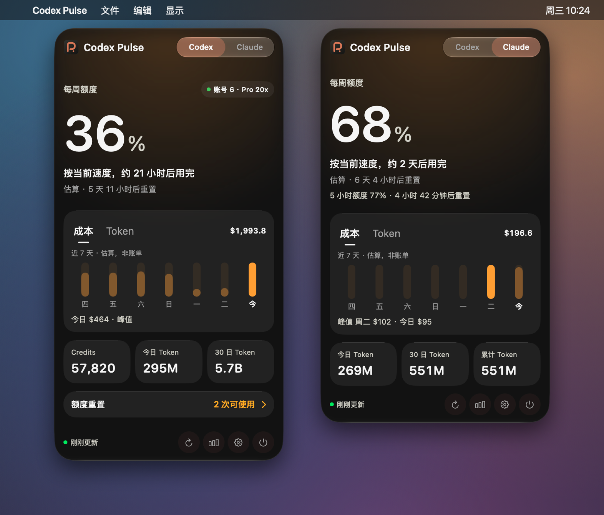

<div align="center">


# Codex Pulse

**在菜单栏和刘海里，随时看清 Codex、Claude Code 与 Grok CLI 的额度、任务和用量。**

[English](README.en.md) · [下载 v1.12.0](https://github.com/suguxiaojie/codex-pulse/releases/tag/v1.12.0) · [MIT License](LICENSE)

macOS 13+ · 原生 SwiftUI / AppKit · Apple Silicon / Intel

</div>

## 它能做什么

Codex Pulse 是一个原生 macOS 菜单栏应用，有三个入口：

- **刘海里的灵动岛**：看正在运行的任务；
- **菜单栏玻璃面板**：随手查额度，个人付费套餐显示 Go／Plus／Pro100／Pro200／Pro500；
- **监控中心**：深入分析用量、成本和会话。

数据通过本机 Codex App Server、桌面 IPC、官方 Grok CLI 和本地会话日志获取。Pulse 不读取账号凭据；Grok 官方 CLI 自行完成账单查询鉴权。

### 灵动岛

- **One Native 异步提问**：通过现有共享 Codex daemon 获取真实提问，支持在当前活动轮次选择选项或输入自定义回答。提交前重新校验问题与轮次，回执未确认时不自动重发；已结束轮次回 One Native 处理。不修改 One Native 或 Codex 配置，详见[接入边界](docs/one-native-questions.md)。

- **Fast 模式**：仅在明确开启时，于展开卡片的模型信息旁显示「Fast」；关闭或未知时不显示。Claude 使用会话状态栏的 `fast_mode`；Codex 读取属于当前会话的 `thread_settings_applied` 设置事件及明确的轮次字段，支持 One 中运行的 Codex CLI；缺少可靠记录时不显示，不以全局配置猜测。隐私模式下隐藏。

- **Clawd 岛内角色**：紧凑态左翼显示 Clawd 与额度，右翼显示任务状态，多任务时加上 ×N。动画使用预渲染帧；卡片头像为静态表情，视线固定。待批准／待回复时岛边呼吸，完成／失败时闪一次；支持关闭角色、三档大小和减少动态效果。
- **硬件黑岛体**：岛体与刘海同色，顶部内凹圆角和菜单栏平滑衔接；边缘有一圈细光，颜色跟随任务状态，强度可在设置里调节。
- **焦点舞台**：展开后只有一张焦点卡片，显示当前任务最多 3 个步骤和本轮 Token，优先保留执行／等待节点；Codex 与 Claude 共用状态文案、颜色和节点规则，结束时保留已知成功／失败，未确认结果显示灰色；其他会话排成一行胶囊，点击即可切换。新出现的待批准／待回复请求会自动抢占焦点；任务完成 3 秒后，焦点转到仍在运行的任务。已结束的会话在列表中保留 1 分钟。收起后暂停展开卡片的动画，再次展开保留回答草稿；实现说明见[焦点舞台](docs/island-focus-stage.md)。
- **岛内审批**：对 Codex 和 Claude Code 当前正在等待的请求，可以在岛内显式批准、选择选项或输入文字回答；Claude Code 提问支持单选、多选勾选和自定义回答，并展示选项说明；其他请求交回原客户端处理，不会自动批准。
- **提醒展开卡**：关注信号和额度恢复会同时发送系统通知与岛内提醒，复用通知设置中的两个开关。提醒沿用设置的展开宽度，高度随内容计算；展示 8 秒，悬停暂停；审批和待回复任务优先，提醒最多排队 3 条。可打开动态中心、原帖或标记手动重置，来源核对后原位更新。
- **重置卡到期提醒**：可用额度重置卡在到期前 24、12、6 小时分别发送系统通知与灵动岛提醒，每张卡每阶段仅提醒一次。“安装与权限”中的开关默认开启。应用运行时随每分钟额度刷新检查；重开应用跨过多个阶段只补当前最紧迫的一次，已使用或过期的卡不提醒。
- **动效**：保留状态烟雾、量子噪点、液态涌浪三种 Metal 进度效果，以及完成彩屑和确认脉冲；"减弱动态效果"打开时全部改为静态显示。

完成反馈支持轻／标准／热烈三档礼花，默认标准；标准与热烈使用屏幕顶部透明覆盖窗口，提醒卡会在庆祝期间暂停排队，结束后恢复剩余时间。完成提示音默认开启，可选择 Glass、Hero、Ping、Purr 或 Submarine，选择时试听；跟随系统音量，连续完成在 2 秒内只响一次。减弱动态效果关闭礼花，不影响提示音。启用关注信号、额度恢复或重置卡到期提醒时，应用启动会在系统尚未决定通知权限的情况下请求一次授权，拒绝后不再自动请求。

数字单位设置现在使用标准设置行与自定义分段，预览当前账号的今日和 30 日 Token；无数据时显示示例，减少动态效果开启时禁用数字过渡。安装与权限页提供统一状态卡，通知已授权时可发送带声音的测试通知，点击通知打开动态中心，不触发灵动岛提醒卡。

### 灵动岛中文输入与跨轮次提问

点击回答输入框时，应用会临时切到前台以支持中文输入法组字；离开输入框后，在原应用仍运行且用户未自行切换前台时归还焦点。未回答的权威异步提问在本轮结束后继续显示“待回复”，不触发完成礼花或提示音；问题解决后恢复普通完成回执。跨轮次回答通过原会话新轮次提交，继承模型、目录和权限；只有在有效回执与后续权威快照中的实际回答共同确认后才显示成功，无法确认时提示到 Codex 查看且不重复发送。


### 菜单栏玻璃面板

- **气象主区**：瓶颈额度窗口的剩余百分比用大号圆体数字显示，并按本周期的消耗速度给出预报：可用到重置，或大约多久后用完（明确标注为估算）。面板颜色跟随额度变化：充足时为冷青，偏紧时为琥珀，告急时为红色。
- **来源切换**：启用 Claude Code 或 Grok CLI 接入后，页眉可切换对应来源。Claude 显示 5 小时和每周额度；Grok 显示服务端返回的真实订阅额度、周期结束时间与共享池标识。
- **7 天条带**：标题本身就是"成本　Token"切换。柱子下只写星期，数值集中在下方一行；有未计价模型的日子标注为"金额未知"。
- **玻璃质感**：保留液态玻璃效果，"面板不透明度"作用于整个面板；系统开启降低透明度或增强对比度时，自动改为不透明。

### 监控中心

- **用量与成本**：按周期查看 Token、缓存、项目排行和趋势。成本按公开模型价格估算，是 API 等价金额，不是订阅账单。官方 Standard 费率同步兼容新旧价格表，缓存写入沿用 30 分钟费率，更新失败保留最后有效值。
- **动态中心**：汇集官方额度、社区动态、重置时间轴和本地恢复记录，并标明各自的来源。
- **会话管理**：搜索项目与会话，查看账号归属和异常摘要；支持导出 Markdown／HTML、原始备份、导入和项目迁移。列表盘点仅缓存元数据与短标题，正文导出仍读取原始日志。
- 项目菜单支持“重命名 Codex 项目”：通过正在运行的桌面项目服务保存真实名称，回读确认后更新会话列表；不改文件夹、路径或会话绑定。Codex 已打开的侧栏可能需要重新打开客户端才刷新。路径对应多个项目、服务不可用或关联 ChatGPT 云端项目时拒绝代改；不直接修改状态文件。
- 没有 Codex 项目登记的历史分组会进入“历史分组显示名称”窗口，按完整路径将名称保存在 Pulse 偏好中，刷新和重启后保留；不新建 Codex 项目，不改日志、路径或会话归属。原生项目名称优先，连接失败与重复登记不会回退为历史分组。
- 删除项目时可保留文件，或将所选项目的独立文件夹及全部内容移入废纸篓。删除文件须核对唯一项目登记与原始工作目录，单独展示完整路径并输入文件夹名确认；共享／嵌套项目、符号链接、目录被替换或归属不明时拒绝文件删除。会话删除前与移动文件前均重新检查范围。
- **Claude Code**：独立的连接开关、权限请求、官方额度，以及本机 Token 与成本历史。灵动岛显示本轮最新公开进展摘要，并展示真实工具步骤及 Bash 命令描述，区分执行、等待、成功、失败与结束；最多显示三个节点，优先保留仍在执行或等待的调用。监控重启后会恢复经本地登记确认仍忙碌的会话，空闲窗口不算运行任务。

### Grok CLI

在监控中心的“Grok CLI”页面开启接入，默认关闭。支持 xAI 官方 `grok`：每分钟通过独立短生命周期 CLI 查询真实订阅剩余比例，手动刷新可立即查询；显示周／月周期、重置时间、统一共享额度池和独立的预付余额。临时上游／网络故障会在总时限内短重试；持续失败时保留明确标记的上次观测，真正的周期结束后不继续显示旧比例；不会把上下文容量当作订阅额度。

本机历史按原始 prompt ID 去重，展示 Token、CLI 报告成本与日期趋势；fork 继承记录不重复相加，缺失成本显示未知。活动会话经进程身份核对后进入灵动岛，显示公开进度、工具步骤和完成反馈；空闲终端不计入活动，旧完成记录不重放提醒。不安装 Hook，监控不自动创建或恢复模型会话。自动接入只在你开启时管理官方共享启动开关，见下文。详见 [Grok CLI 接入说明](docs/grok-cli-integration.md)。

**自动接入问答与批准**：首次在 Grok CLI 页面开启自动接入后，照常在任意项目运行 `grok`，Pulse 自动识别会话与项目，无需选择目录或另建终端。配置仅管理官方 `cli.use_leader` 开关，先备份原设置；其余配置保持原样，不读取账号凭据。新设置影响之后正常启动的 Grok，当前独立任务不被重启或迁移。连接后收到的新问题支持单选、多选与文字回答；具备完整操作参数的工具请求可显式“允许一次”或“拒绝”，保留原生选项 ID，不生成长期授权。原端先答时撤销岛内控件，断线不取消原请求、不重发未知结果；旧待处理请求、计划批准等回原终端。关闭 Pulse 监控不撤销 Grok 的共享启动设置，原状态备份可用于回退。详见 [岛内问答边界](docs/grok-island-questions.md)。

### 数字单位

大数字默认用中文万／亿显示，例如 `8,432`、`541万`、`1.84亿`。可在"菜单栏与面板 → 内容 → 用量 → 数字单位"中切换为 K／M／B。金额、百分比和会话数不受影响。

## 界面预览

### 灵动岛

<p align="center">
  
</p>

### 菜单栏玻璃面板

<p align="center">
  
</p>

### 监控中心

<p align="center">
  
  
</p>
<p align="center">
  
  
</p>
<p align="center">
  
</p>

### 设置

<p align="center">
  
  
</p>

<details>
<summary>安装与权限</summary>
<p align="center">
  
</p>

</details>

## 下载与安装

当前版本：**v1.12.0（Build 34）**。在 [GitHub Releases](https://github.com/suguxiaojie/codex-pulse/releases/tag/v1.12.0) 下载与你的 Mac 对应的安装包：

| Mac 处理器 | 安装包 |
|---|---|
| Apple Silicon（M 系列） | [arm64 DMG](https://github.com/suguxiaojie/codex-pulse/releases/download/v1.12.0/CodexNotchMonitor-v1.12.0-arm64.dmg) |
| Intel | [x86_64 DMG](https://github.com/suguxiaojie/codex-pulse/releases/download/v1.12.0/CodexNotchMonitor-v1.12.0-x86_64.dmg) |

1. 打开 DMG，把 App 拖进"应用程序"。
2. 启动 App。确保 Codex／ChatGPT Desktop 已安装并登录。
3. 按需开启通知；任务监控的连接状态可在"安装与权限"中查看。

应用使用临时签名，尚未经过 Apple 公证。如果系统拦截首次打开，请先确认下载来源，再到"系统设置 → 隐私与安全性"中允许打开。

应用由 Codex Monitor 更名而来，Bundle ID、`CodexNotchMonitor.app` 文件名、偏好设置和数据目录都沿用原值，升级后原有配置和数据继续可用。应用内的"检查更新"只打开下载页，安装仍由你自己完成。

## 数据来源与边界

| 内容 | 来源与说明 |
|---|---|
| 官方额度与账号 | 本机 Codex App Server，显示额度比例和重置时间，不等于剩余消息条数 |
| 额度预报 | 由当前窗口的已用比例和已过时间推算，只是估算；周期开始不足 1 小时时不预测 |
| Token 与项目统计 | 本机结构化会话日志，包含缓存，只覆盖本机仍能读到的历史 |
| 实时任务 | Codex 来自桌面 IPC 和本地日志；Claude Code 来自专属 Hook 与本地登记；Grok CLI 来自通过进程身份核对的本地通知流 |
| 成本 | Codex／Claude 按 Token × 公开模型价格估算，Grok 使用 CLI 报告的轮次成本；**均不等于订阅账单**，未知金额明确标注 |
| 社区动态与预测 | 第三方聚合 [codex-reset.com](https://codex-reset.com/zh/tibo)，预测不保证你的账号会重置 |
| 会话账号归属 | 只采用可靠观察到的证据；基线之前或证据不足的记录保持"未归属" |

- 不读取 `auth.json`、Cookie、API Key、Claude 凭据或 Keychain；本地会话、项目和用量不会上传给社区源或价格目录。
- Codex 任务监控不安装 Hook，也不写入 Codex 客户端配置。Claude Code 接入默认关闭；启用前会先备份 `settings.json`，只管理本应用自己的条目；停用时恢复原来的状态栏，并保留其他工具的配置。
- 导入、恢复、删除、迁移和手动额度重置都是你主动发起的操作，执行前会展示影响范围；额度重置需要二次确认。
- 可读导出默认遮盖敏感正文；原始备份和迁移包可能包含源码、提示词和附件，请自行妥善保管。

## 从源码构建

需要 Swift 6 工具链和 macOS 构建工具，不依赖第三方 Swift Package。

```bash
git clone https://github.com/suguxiaojie/codex-pulse.git
cd codex-pulse
./scripts/build-app.sh native        # 构建当前架构
open build/CodexNotchMonitor.app
```

```bash
./scripts/test.sh                    # 完整测试（含 Claude 接入专项）
SKIP_COST_SMOKE_TESTS=1 ./scripts/test.sh # 不允许读取真实用量日志时跳过 CostSmokeTests
./scripts/build-dmg.sh arm64         # Apple Silicon 安装包
./scripts/build-dmg.sh x86_64        # Intel 安装包
```

更多文档：

- [灵动岛审批](docs/island-approvals.md)
- [Claude Code 接入说明](docs/claude-code-integration.md)
- [Grok CLI 接入说明](docs/grok-cli-integration.md)
- [压缩历史会话读取](docs/compressed-rollouts.md)
- [项目进度](ROADMAP.md)

## 致谢与许可

感谢 [Codex Island](https://github.com/ericjypark/codex-island)、[QuotaView](https://github.com/Duoasa/QuotaView) 和 [Open Claude UI](https://github.com/Caho1/open-claude-ui)。第三方来源和完整许可见 [THIRD_PARTY_NOTICES.md](THIRD_PARTY_NOTICES.md)。

本项目采用 [MIT License](LICENSE)，Copyright (c) 2026 CoverAI。Codex Pulse 是独立项目，与 OpenAI、Anthropic 没有官方关联。

支持项目：[CoverAI 自家代充服务](https://www.coverai.store/)。
